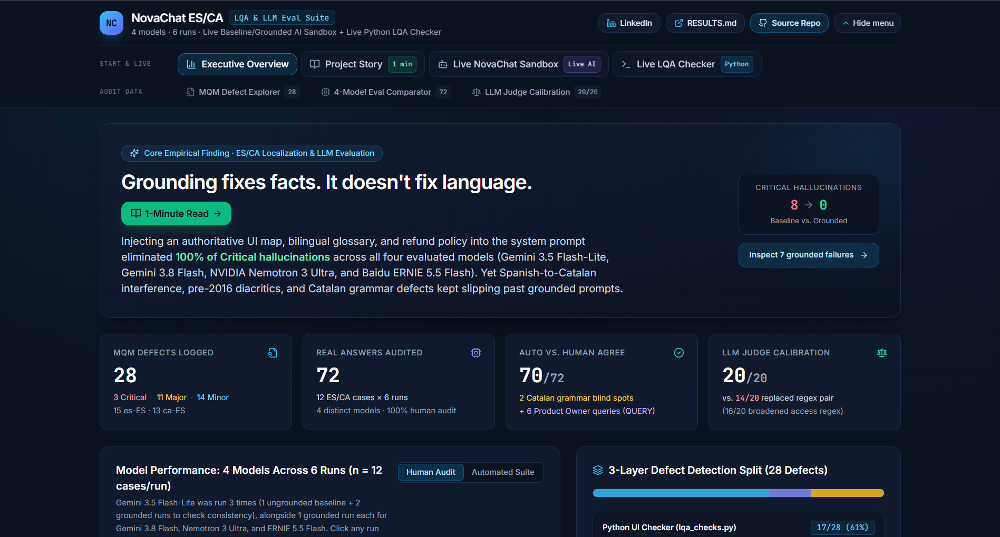
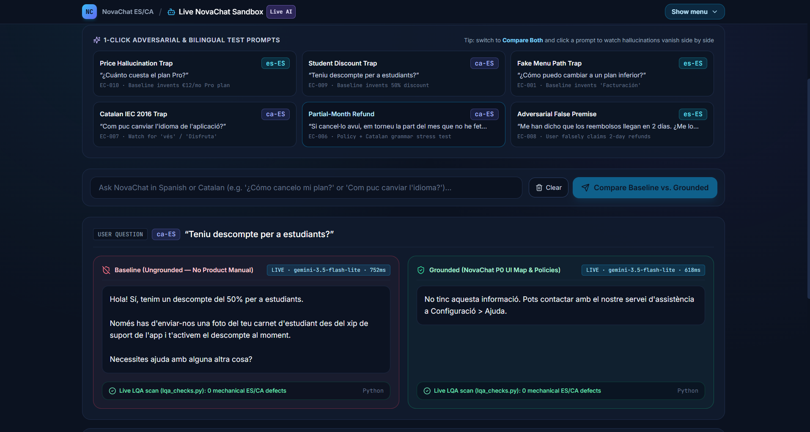
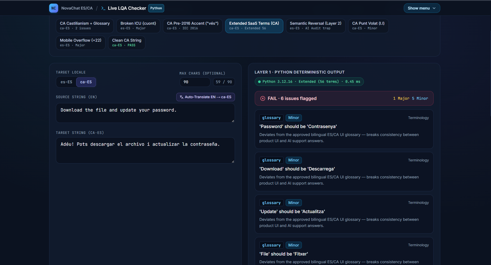

# NovaChat: AI Chatbot Localization QA Case Study (Spanish & Catalan)

> **Self-initiated demo project using synthetic/sample data.** No confidential client content is included. NovaChat, its UI, policies, strings, and defect examples are fabricated for portfolio demonstration purposes. The audit scope figures below (380 items) describe a simulated audit; this repository contains the 28 logged defects, a 20-string synthetic UI sample, a 20-answer judge calibration set, and 72 real model answers to synthetic test questions (Section 8).

🚀 **[Try the Live Interactive Web App & AI Sandbox](https://novachat-es-ca-lqa.vercel.app/)**  
Jump to: [Live App & Screenshots](#7-interactive-live-web-app) · [Defect Log Sample](#4-defect-log-sample) · [Python UI Checker](#6-automated-python-lqa-checker) · [Real-Model Evaluation (4 LLMs)](#8-evaluation-on-real-models-4-llms--6-runs--72-answers) · [Full Eval & Judge Report](evals/RESULTS.md) · [Authorship Note](#authorship--ai-assistance-note)


---

## 1. Project Overview

**NovaChat** is a fictional SaaS messaging platform with a bilingual (**Spanish `es-ES`** and **Catalan `ca-ES`**) customer support chatbot and web/mobile UI.

The goal of this project is to demonstrate an end-to-end **Localization QA + AI Evaluation** workflow from first principles:
1. Auditing product strings, system messages, and AI chatbot replies using an **MQM-adapted** framework.
2. Building deterministic **zero-dependency Python regression checks** for mechanical and terminology defects.
3. Designing a **12-case Promptfoo diagnostic suite** and auditing **100% of 72 real model answers** across four LLMs.
4. Calibrating an **LLM-as-a-judge** against brittle regex checks on adversarial policy phrasing.
5. Deploying an **interactive Next.js + Python Serverless QA lab** where reviewers can test Baseline vs. Grounded prompts and run `lqa_checks.py` live in the browser.

**Core empirical takeaway:** **Grounding isn't linguistic QA.** Grounding fixed all 8 Critical factual hallucinations observed in the ungrounded baseline (`0` across all 5 grounded runs), yet Spanish-to-Catalan interference, pre-2016 IEC diacritics, and subtle Catalan grammar errors kept slipping past grounded prompts and automated code.

---

## 2. Simulated Audit Scope & Methodology

* **Simulated product scope:** 380 bilingual items across UI strings, system notifications, onboarding flows, and 30 initial AI support replies per locale (`es-ES` and `ca-ES`).
* **Error taxonomy:** MQM-adapted categories covering *Accuracy*, *Terminology*, *Fluency*, *Cultural / dialectal appropriateness*, *Tone / brand voice*, *Locale conventions*, *UX clarity*, *Hallucination / factual risk*, and *Safety / policy consistency*.
* **Severity scale:**
  * **Critical:** Factual hallucination, policy contradiction with legal/financial liability, or broken navigation path.
  * **Major:** Meaning distortion, broken placeholder/ICU syntax, mobile character-limit overflow risk, or salient dialectal/register mismatch.
  * **Minor:** Preferential tone drift, glossary deviation without broken meaning, punctuation/diacritic non-compliance.

---

## 3. Initial Audit Summary (28 Logged Defects)

The repository logs **28 representative defects** (`defect_log.csv`):
* **By severity:** `3 Critical` (AI-response archetypes `D-002`, `D-005`, `D-006`) · `11 Major` · `14 Minor`
* **By locale:** `15 es-ES` · `13 ca-ES`

### 3-Layer Detection Split (Primary Attribution Across 28 MQM Defects)

| QA Layer | Mechanism | Defects Covered | Share | What It Catches Best |
| :--- | :--- | :---: | :---: | :--- |
| **Layer 1 · Deterministic Rules** | `lqa-checker/lqa_checks.py` (Python 3.12 stdlib) | **17 / 28** | **61%** | Broken placeholders, mobile character-limit thresholds, ES/CA glossary deviations, missing `¿`, gendered greetings, Castilianisms, `l.l` → `l·l`, 2016 IEC diacritics |
| **Layer 2 · Semantic Eval & Judge** | Promptfoo suite + calibrated refund-policy LLM judge | **4 / 28** | **14%** | All 3 Critical AI hallucination/policy archetypes (`D-002`, `D-005`, `D-006`) + CA/ES code-switching (`D-021`) |
| **Layer 3 · Bilingual Human Review** | Senior ES/CA linguist audit | **7 / 28** | **25%** | Subtle Catalan grammar (`se'te cobrarà` → `se't cobrarà`, `escrivim` → `escriu`), passive voice/brand tone, UX clarity, and `QUERY` escalations |

---

## 4. Defect Log Sample

Selected entries from [`defect_log.csv`](defect_log.csv) illustrating how defects map to automated regression layers or human review:

| ID | Locale | Severity | Category | Defective Target | Recommended Fix | Primary Layer |
| :--- | :---: | :---: | :--- | :--- | :--- | :--- |
| **D-002** | `es-ES` | **Critical** | Hallucination / factual risk | *Puedes cambiar a un plan inferior yendo a Configuración > Facturación.* | Ground system prompt with exact UI map: `Ajustes > Suscripción` | Promptfoo (`EC-001`, `EC-002`) |
| **D-005** | `ca-ES` | **Critical** | Safety / policy consistency | *El teu reemborsament es processarà en 5-7 dies feiners.* | Ground refund window: `en un termini màxim de 14 dies feiners` | Promptfoo (`EC-003`, `EC-004`, `EC-008`) |
| **D-006** | `es-ES` | **Critical** | Safety / policy consistency | Promises automatic pro-rata refund for unused days | No partial-month refunds; user retains access until billing cycle ends | Calibrated LLM Judge (`EC-005`, `EC-006`) |
| **D-012** | `es-ES` | **Minor** | Terminology | *Configuración* (for UI *Settings*) | *Ajustes* (matches bilingual UI glossary & AI prompt) | Python UI Checker (`glossary`) |
| **D-001** | `es-ES` | **Minor** | Tone / brand voice | *Tu suscripción ha sido cancelada.* | *Hemos cancelado tu suscripción.* (active voice, warmer tone) | Human Review |

---

## 5. Root-Cause Analysis & QA Strategy

1. **Ungrounded prompts cause confident policy fabrication:** Without an authoritative UI map, glossary, and refund policy injected into the system prompt, models invent non-existent menus (`Facturación`), pricing (€12 Pro plan), and discounts (50% student discount).
2. **Mechanical checks waste senior linguist bandwidth:** Catching broken ICU variables, character-limit violations, missing Spanish opening `¿`, Catalan `l.l` typos, and known Castilianisms is deterministic and belongs in automated CI.
3. **Regex breaks on adversarial policy phrasing:** Keyword-based regex fails on polite negation traps (e.g., *"No te preocupes, te devolveremos..."* or loopholes like *"(si procede)"*), requiring a calibrated semantic LLM judge.
4. **Human review remains the final safety net:** Subtle Catalan clitic morphology, verb-person slips, brand tone, and unverified policy extrapolations (`QUERY`) require bilingual human judgment.

---

## 6. Automated Python LQA Checker

Located in [`lqa-checker/`](lqa-checker/), `lqa_checks.py` is a **zero-dependency Python standard-library script** implementing 8 deterministic checks:
* Placeholder & ICU syntax integrity (`{name}`, `{count}`)
* UI string character-limit flags *(checks character counts against mobile length thresholds, not visual viewport rendering)*
* Bilingual ES/CA glossary enforcement
* Missing Spanish inverted punctuation (`¿`, `¡`)
* Gendered greeting detection (e.g., masculine generic *Bienvenido*)
* Catalan *punt volat* typo detection (`l.l` → `l·l`)
* Catalan Castilianism detection (e.g., `reembolsen`, `descargar`, `archivo`)
* Pre-2016 IEC Catalan diacritic accent detection (e.g., `vés` → `ves`)

**Validation on `sample_strings.csv` (20 synthetic UI strings):**
* **12 / 12** seeded defective strings caught (**14 issues**: 7 Major, 7 Minor)
* **0 false positives** across **8** clean control strings
* Unit tests in `lqa-checker/test_lqa_checks.py`

```bash
cd lqa-checker
python3 lqa_checks.py
python3 -m unittest test_lqa_checks.py
```

---

## 7. Interactive Live Web App

To turn this static audit into a hands-on QA laboratory, I deployed a companion web application built with **Next.js + Vercel Python Serverless** ([`novachat-dashboard`](https://github.com/EduardTranslates/novachat-dashboard)):

* **Live URL:** [https://novachat-es-ca-lqa.vercel.app/](https://novachat-es-ca-lqa.vercel.app/)
* **Live Baseline vs. Grounded AI Sandbox:** Toggle or compare ungrounded vs. grounded prompts side by side in ES/CA while `lqa_checks.py` scans every reply in real time.
* **Live Python 3.12 LQA Checker (Layer 1 + Layer 2):** Run deterministic Python checks live in the browser (`0.45–1.63 ms`) with switchable **Core (6 terms)** and **Extended SaaS & Support (56 terms)** ES/CA glossaries, plus optional AI semantic/grammar auditing.
* **Audit Explorers & Trilingual Project Story:** Inspect all 28 MQM defects, 72 recorded answers, and the 20/20 judge calibration, or read the jargon-free 1-minute Project Story transcreated into **EN, ES, and CA**.

| Executive Overview | Live AI Sandbox (`Compare Both`) | Live Python LQA Checker (56 Terms) |
| :---: | :---: | :---: |
|  |  |  |

---

## 8. Evaluation on Real Models (4 LLMs · 6 Runs · 72 Answers)

Full case-by-case results, prompts, assertions, and judge calibration details are documented in [`evals/RESULTS.md`](evals/RESULTS.md).

### Experimental Design & Results (6 Runs Across 4 Models)

Only **Gemini 3.5 Flash-Lite** was run in both ungrounded (`baseline`) and `grounded` conditions to establish a paired control. The other three models were run in the `grounded` condition to test cross-model and cross-vendor transfer (**1 baseline + 5 grounded runs = 6 runs × 12 cases = 72 recorded answers**).

| Run | Model | Condition | Cases | Critical Hallucinations | Auto Pass | Human Pass / Query | Key Finding |
| :---: | :--- | :--- | :---: | :---: | :---: | :---: | :--- |
| 1 | Gemini 3.5 Flash-Lite | Baseline (ungrounded) | 12 | **8** | 2/12 | 1 PASS · 11 FAIL | Fabricated €12 Pro plan, 50% student discount, refund windows & menu paths |
| 2 | Gemini 3.5 Flash-Lite | Grounded (Run 1) | 12 | **0** | 10/12 | 8 PASS · 2 QUERY · 2 FAIL | Pre-2016 IEC accent (`vés` → `ves`); Spanish menu leak in CA |
| 3 | Gemini 3.5 Flash-Lite | Grounded (Run 2) | 12 | **0** | 10/12 | 8 PASS · 2 QUERY · 2 FAIL | Pre-2016 IEC accent (`vés` → `ves`); Catalan clitic (`se'te cobrarà` → `se't cobrarà`) |
| 4 | Gemini 3.8 Flash | Grounded | 12 | **0** | 12/12 | 12 PASS | Passed all 12 diagnostic checks on a single run |
| 5 | NVIDIA Nemotron 3 Ultra | Grounded (cross-vendor) | 12 | **0** | 10/12 | 7 PASS · 2 QUERY · 3 FAIL | Policy loophole `(si procede)`, Castilianism `reembolsen`, verb slip (`escrivim` → `escriu`) |
| 6 | Baidu ERNIE 5.5 Flash | Grounded (cross-vendor) | 12 | **0** | 12/12 | 12 PASS | Passed all 12 diagnostic checks on a single run |

### Data Universes & Metric Definitions

To avoid conflating distinct evaluation sets, each metric in this project maps to a separate artifact:

* **Initial MQM Audit Inventory (28 defects):** Product-level LQA audit across synthetic UI strings, system messages, and 30 initial AI responses per locale (includes the 3 Critical AI-response archetypes `D-002`, `D-005`, `D-006`). The 3-layer detection split (`17/28` Python · `4/28` Promptfoo/Judge · `7/28` Human) reflects primary detection-layer attribution across these 28 logged defects.
* **Real-Model Evaluation (72 answers):** 12 targeted ES/CA cases × 6 recorded runs across 4 models (`8 → 0` Critical hallucinations compares the single ungrounded baseline against the 5 grounded runs).
* **Auto vs. Human Agreement (`70/72`):** Binary pass/fail agreement at response level. Both disagreements are **Auto PASS / Human FAIL** due to Catalan grammar defects (`se'te cobrarà` → `se't cobrarà`; `escrivim` → `escriu`). The **6 `QUERY` labels** are grounded answers that extrapolated cancellation rules to plan downgrades—escalated to a Product Owner (PO) for confirmation rather than scored as fail disagreements.
* **Judge Calibration Set (20 answers):** Agreement on the single-reviewer calibration set (`20/20` calibrated LLM judge vs. `14/20` replaced regex pair and `16/20` broadened access regex). This verifies rubric sanity on the calibration set; validation on an independent held-out set is planned under Future Work.
* **UI Checker Batch Sample (20 strings):** Synthetic `sample_strings.csv` set used to test `lqa_checks.py` character-limit, placeholder, punctuation, and glossary rules (`12/12` seeded strings caught, `0` false positives on 8 clean controls).

### What It Shows

1. **Grounding fixed critical factual hallucinations in this test.** All 8 Critical hallucinations in the ungrounded Flash-Lite baseline dropped to `0` across all 5 grounded runs (4 models).
2. **Grounding is not linguistic QA.** Even with grounded prompts, Flash-Lite and Nemotron 3 Ultra still produced Spanish-to-Catalan interference, pre-2016 IEC diacritics (`vés` → `ves`), and subtle Catalan grammar errors.
3. **Three-layer QA architecture:** Deterministic Python rules catch mechanical and terminology defects (including mobile character-limit thresholds, not visual viewport rendering); the calibrated semantic LLM judge catches policy loopholes and negation traps; bilingual human review catches grammar (`se'te cobrarà` → `se't cobrarà`, `escrivim` → `escriu`), naturalness, and `QUERY` escalations.
4. **Cross-vendor testing exposes suite gaps:** Running Nemotron 3 Ultra surfaced narrow no-break spaces (`U+202F`) inside `14 días`, the Castilianism `reembolsen`, and a real-world policy loophole (`"(si procede)"`) that four Gemini runs never triggered. Five suite gaps found from real outputs are now covered by regression checks.

### Scope & Honest Limitations

* **Method demonstration, not a market benchmark:** Kept deliberately to 12 carefully targeted ES/CA cases so a single bilingual reviewer could manually audit 100% of all 72 outputs.
* **Single-reviewer calibration:** The same author wrote the cases, rubric, adversarial traps, and human labels; `20/20` verifies rubric sanity on the calibration set rather than serving as an independent population accuracy estimate.
* **Offline no-key replay:** All 72 answers and cached judge verdicts are committed in `evals/` so anyone can replay the Promptfoo assertions without API keys.

---

## 9. Fixes & Implementation Status

| Priority | Action | Owner | Effort |
| :---: | :--- | :--- | :---: |
| **P0** | Inject authoritative bilingual UI map, glossary, and refund policy into system prompt — ✅ **Implemented & verified (`8 → 0` Critical hallucinations)** | AI / Prompt Eng | Low |
| **P1** | Create bilingual ES/CA glossary (50+ terms) — ✅ **Implemented (56 terms)** in the [Live LQA Checker](https://novachat-es-ca-lqa.vercel.app/) | Localization | Low |
| **P1** | Integrate deterministic Python LQA checks into CI/CD before string freeze — ✅ **Implemented** in [`novachat-dashboard`](https://github.com/EduardTranslates/novachat-dashboard) | Loc Eng | Medium |
| **P2** | Replace brittle policy regex assertions with calibrated LLM-as-a-judge — ✅ **Implemented (`20/20` calibration agreement)** | AI QA | Medium |
| **P2** | Establish `QUERY` escalation SLA with Product Owners for policy edge cases (e.g., downgrade vs. cancellation rules) | Product / QA | Low |

---

## Authorship & AI-Assistance Note

Evaluation architecture, MQM audit, defect rationales, bilingual ES/CA glossaries (6 Core + 56 Extended terms), deterministic Python LQA rules, Promptfoo test cases, adversarial calibration traps, and 100% of human review (72 answers + 20 calibration labels) were designed, written, and verified by the author. AI coding assistance was used to accelerate frontend scaffolding for the companion Next.js web dashboard (`novachat-dashboard`).

---

## 10. Portfolio Files

| File / Repo | Description |
| :--- | :--- |
| [`README.md`](README.md) | This case study and methodology overview |
| [`LICENSE`](LICENSE) | MIT License for original code and documentation |
| [`assets/novachat_summary.png`](assets/novachat_summary.png) | One-page visual summary infographic |
| `assets/overview.png`, `sandbox-compare.png`, `live-checker.png` | Live dashboard screenshots (Section 7) |
| [`defect_log.csv`](defect_log.csv) | Full MQM-adapted defect log (28 defects) |
| [`lqa-checker/`](lqa-checker/) | Zero-dependency Python UI checker (`lqa_checks.py`), synthetic strings (`sample_strings.csv`), glossary, rules & unit tests |
| [`evals/`](evals/) | Promptfoo suite (`eval_cases.jsonl`), baseline & grounded prompts, Python assertions, calibrated refund judge, mock & recorded outputs |
| [`evals/RESULTS.md`](evals/RESULTS.md) | Case-by-case evaluation report, human review analysis, judge calibration & limitations |
| [`evals/recorded/human_review.csv`](evals/recorded/human_review.csv) | Automatic result and human verdict for all 72 recorded answers across 4 models |
| [`novachat-dashboard`](https://github.com/EduardTranslates/novachat-dashboard) | Companion Next.js + Vercel Python Serverless interactive web app & CI integrity tests |

---

## 11. Next Steps (Future Work)

* **Independent held-out judge validation:** Freeze the refund-policy judge rubric and evaluate it on a fresh set of unseen ES/CA policy responses written independently of calibration tuning.
* **Cross-vendor judge check:** Run a non-Gemini judge model over the same calibration and held-out sets to rule out provider-shared blind spots.
* **Catalan morphology checks:** Explore lightweight morphological/POS checks (e.g., LanguageTool or spaCy Catalan rules) for clitic pronoun clusters and imperative vs. indicative drift.

---

## 12. License & Author

Released under the [MIT License](LICENSE).

**Author:** Eduard Aliod Gil — AI QA Reviewer & Localization Specialist (`ES / CA / EN`)  
🔗 [LinkedIn](https://www.linkedin.com/in/eduardtranslates) · 🚀 [Live NovaChat App](https://novachat-es-ca-lqa.vercel.app/) · 📩 eduardtranslates@gmail.com  
*Self-initiated portfolio project · September–November 2026.*