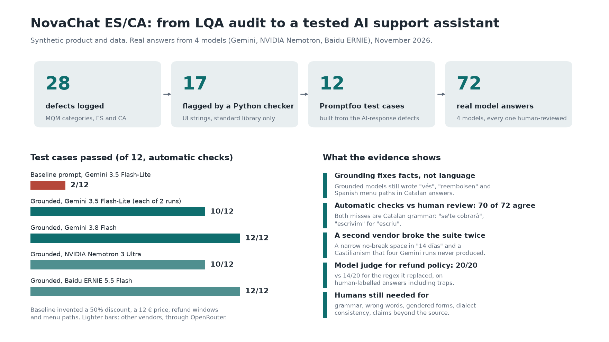

# AI Chatbot Localization QA Case Study: Spanish & Catalan

> **Self-initiated demo project using synthetic/sample data.** No confidential client content. NovaChat, its UI, policies, strings and defect examples are fabricated for portfolio demonstration purposes. The audit scope figures below (380 items) describe a simulated audit; the repository contains the 28 logged defects, a 20-string sample and 72 real model answers to synthetic test questions (section 8).



**Jump to:** [Defect Log Sample](#6-defect-log-sample) · [Real-Model Evaluation (4 LLMs)](#8-evaluation-on-real-models) · [Full Eval & Judge Report](evals/RESULTS.md) · [Python UI Checker](lqa-checker/)

### Quick reproduce (no API key needed)

From the repository root, with Python 3 and a Node.js version supported by Promptfoo installed:

```bash
python lqa-checker/lqa_checks.py
cd evals
npx promptfoo@0.121.20 eval -c promptfooconfig.recorded.yaml
python calibrate_judge.py
```

The commands audit the 20 UI sample strings, grade all 72 recorded answers, and compare cached judge verdicts with 20 human labels. They do not call any model API. The first `npx` run needs Internet to install Promptfoo; subsequent runs can replay locally with the installed version. Known defective answers deliberately fail the eval, so a non-zero eval exit code is expected. Calibration replays saved verdicts; it does not obtain a fresh judge assessment.

---

## 1. Executive Summary

LQA audit of a fictional AI chatbot SaaS product preparing for launch in the Spanish and Catalan markets. Reviewed 120 UI strings, 40 system messages, and 30 generated AI responses across both locales. Identified 28 defects across 9 MQM-adapted categories. Recommended 5 regression tests and a bilingual ES/CA glossary to prevent recurrence. The AI-response tests were then built as a 12-case Promptfoo suite and run on four real models (two Gemini, two from other vendors through OpenRouter): with the grounded system prompt, hallucinations disappeared, but Catalan language errors remained on two of the four models (section 8).

| Metric | ES | CA | Total |
|---|---|---|---|
| UI strings reviewed | 120 | 120 | 240 |
| System messages | 40 | 40 | 80 |
| AI responses | 30 | 30 | 60 |
| Total items | 190 | 190 | 380 |
| Defects found | 15 | 13 | 28 |
| Critical | 2 | 1 | 3 |
| Major | 6 | 5 | 11 |
| Minor | 7 | 7 | 14 |

---

## 2. Project Context

**Product:** "NovaChat" (fictional) — an AI-powered customer support chatbot for a mid-sized SaaS company. The chatbot handles subscription queries, onboarding assistance, and technical troubleshooting.

**Target markets:** Spain (es-ES) and Catalonia (ca-ES).

**Why LQA matters here:** AI chatbot products carry unique localization risks that traditional software LQA does not fully cover. A mistranslated UI string is a usability issue; a hallucinated AI response in a safety-critical context (e.g., billing disputes, account cancellation) is a legal and reputational risk. This audit covers both traditional UI localization quality and AI-output quality.

---

## 3. Scope

| Content type | ES | CA | Risk level | Key criteria |
|---|---|---|---|---|
| UI strings | 120 | 120 | Medium | Consistency, truncation, ICU variables |
| System messages | 40 | 40 | High | Clarity, tone, safety register |
| AI responses | 30 | 30 | Critical | Hallucination, bias, policy compliance |
| Onboarding flow (subset of UI strings) | 15 | 15 | Medium | UX flow, terminology, CTA clarity |

**Out of scope:** Marketing copy, legal pages (ToS, privacy policy), app store descriptions. These would require separate review cycles with legal and marketing stakeholders.

---

## 4. Quality Framework

MQM-adapted framework for AI products. The first seven categories are standard MQM; the last two are specific to AI-output evaluation and represent the added value of an AI Language Quality Specialist over a traditional LQA reviewer.

| Category | What it checks | Severity default |
|---|---|---|
| Accuracy | Does the translation convey the source meaning correctly? | Major |
| Fluency | Is the text natural and grammatically correct? | Minor |
| Terminology | Does it follow the glossary and style guide? | Minor |
| Locale conventions | Are date, currency, number formats correct for the locale? | Minor |
| Tone / brand voice | Does it maintain the product's register and voice? | Minor |
| UX clarity | Is the message understandable to the end user? | Major |
| Safety / policy consistency | Do generated AI responses comply with safety policies? | Critical |
| Cultural / dialectal appropriateness | Is the content appropriate for the cultural and dialectal context? | Major |
| Hallucination / factual risk | Does the AI response invent information not present in the source or knowledge base? | Critical |

---

## 5. Methodology

1. **Linguistic pass:** Side-by-side review of source (EN) and target (ES/CA) strings and messages. Checked for accuracy, fluency, terminology, and locale conventions.
2. **UX pass:** Verified string length constraints (mobile viewport), ICU variable formatting (`{name}`, `{count}`), button/CTA consistency, and truncation risks.
3. **AI-output evaluation:** Reviewed 30 generated responses per locale for hallucinations, cultural bias, safety policy compliance, and factual accuracy. Responses were generated from a test prompt set covering common user intents (billing, onboarding, troubleshooting, cancellation).
4. **Severity scoring:** Each defect assigned Critical, Major, or Minor based on user impact.
   - **Critical:** Could cause legal liability, safety risk, or severe user harm.
   - **Major:** Could confuse users or damage brand perception; should be fixed before release.
   - **Minor:** Polish issues; can be fixed in a later iteration.
5. **Before/after documentation:** Each defect includes the original text, the issue, and the recommended fix with rationale.
6. **Regression recommendations:** For each recurring defect pattern, proposed an automated or manual test to prevent regression in future updates.

---

## 6. Defect Log (Sample)

> Full defect log available in `defect_log.csv`. Below is a representative sample.

| ID | Source / reference (EN) | Current (ES/CA) | Issue type | Severity | Explanation | Recommended fix | Rationale |
|---|---|---|---|---|---|---|---|
| D-001 | "Your subscription has been cancelled." | (ES) "Tu suscripción ha sido cancelada." | Tone / brand voice | Minor | Passive voice sounds cold and bureaucratic; the style guide asks for active voice and informal register (tú). | "Hemos cancelado tu suscripción." | Aligns with active voice and informal register per style guide. Warmer tone for a cancellation message. |
| D-002 | Prompt: "How do I downgrade my plan?" Ground truth: Settings > Subscription. | (ES) "Puedes cambiar a un plan inferior yendo a Configuración > Facturación." | Hallucination / factual risk | Critical | The response references a 'Billing' menu that does not exist in the product UI. The correct path is Settings > Subscription. The model hallucinated the navigation path. | Fix the system prompt to include exact UI paths. Correct response: "Puedes cambiar a un plan inferior en Ajustes > Suscripción." | Hallucinated navigation paths cause user frustration and support tickets. The system prompt must contain an authoritative UI map. |
| D-003 | "Welcome back, {name}!" | (ES) "¡Bienvenido de nuevo, {name}!" | Cultural / dialectal appropriateness | Major | 'Bienvenido' is a masculine generic. Inconsistent with the inclusive language policy for a gender-neutral product. | "¡Hola de nuevo, {name}!" | Neutral greeting that avoids gendered language while keeping warmth. |
| D-004 | "Error 403: You don't have permission to access this resource." | (CA) "Error 403: No tens permís per accedir a aquest recurso." | Cultural / dialectal appropriateness | Major | Lexical Castilianism: 'recurso' is the Spanish form; the correct Catalan word is 'recurs'. The rest of the string is correct Catalan. Typical interference when CA strings are adapted from the ES version instead of translated from EN. | "Error 403: No tens permís per accedir a aquest recurs." | Correct Catalan lexis. 'recurso' added to the checker's Castilianism list to prevent recurrence. |
| D-005 | Prompt: "When will I get my refund?" Policy: refunds are processed within up to 14 business days. | (CA) "El teu reemborsament es processarà en 5-7 dies feiners." | Safety / policy consistency | Critical | The response guarantees a 5-7 day refund window that contradicts the refund policy ("up to 14 business days"). Factual error with potential legal liability. | Update the system prompt with the exact refund policy text. The response should state "en un termini màxim de 14 dies feiners" or link to the policy. | Incorrect refund timeframes can create legal obligations and false expectations. The model must not invent policy details. |

---

## 7. Key Findings

1. **All 3 Critical defects are in AI responses, and none is detectable by rule-based checks.** The model hallucinated a navigation path (D-002), a refund timeframe (D-005) and a pro-rata refund policy (D-006). These need an eval set with ground-truth answers, not string checks. That set now exists in [`evals/`](evals/).
2. **Spanish interference is the main risk in Catalan.** 3 Major CA defects come from Spanish: Castilianisms in UI and system messages (D-004, D-018) and an AI response that switches to Spanish mid-answer (D-021).
3. **17 of 28 defects (61%) are mechanically detectable.** Placeholders, length, glossary, gendered terms, punctuation and whitespace are covered by the [`lqa-checker`](lqa-checker/) script. The 4 AI-response defects (D-002, D-005, D-006, D-021) are covered by the [`evals`](evals/) Promptfoo suite. The remaining 7 need human linguistic review.
4. **Variable handling is fragile in both locales.** One misspelled ICU variable rendered literally (D-007), one dropped `%s` (D-020) and one hardcoded US-format date instead of `{date}` (D-025).
5. **Inclusive language and register drift affect both locales.** Masculine generic greetings (D-003, D-019) and formal "usted/vostè" forms in onboarding (D-017, D-026), against a style guide that requires neutral greetings and informal register.
6. **Tested on real models: grounding fixes facts, not language.** Without the UI map and policies, Gemini 3.5 Flash-Lite failed 10 of 12 cases. With them, it passed every fact and policy check but still made Catalan errors. Two models from other vendors confirmed the pattern and exposed suite gaps that Gemini had not. Details in section 8.

---

## 8. Evaluation on Real Models

The defect log (section 6) found the AI-response risks; the eval suite in [`evals/`](evals/) turns them into 12 test cases; this section runs those cases on real models. Full report: [`evals/RESULTS.md`](evals/RESULTS.md).

### Setup

| Item | Value |
|---|---|
| Models | Gemini 3.5 Flash-Lite, Gemini 3.8 Flash (Gemini API, free tier); cross-vendor check with NVIDIA Nemotron 3 Ultra and Baidu ERNIE 5.5 Flash (OpenRouter, free tier) |
| Date | 15-16 November 2026 |
| Configuration | Temperature 0. Grounded prompt (UI map, glossary, policies: the P0 fix) vs baseline prompt (same style rules, no grounding) |
| Test set | 12 cases, 6 es-ES and 6 ca-ES, linked to defects D-002, D-003, D-005, D-006, D-016, D-017, D-019, D-021, D-026 |
| Automatic checks | Promptfoo regex + Python assertions; a model-graded judge (Gemini 3.5 Flash) for the refund cases EC-005/006 |
| Human review | All 72 answers read by the author (bilingual ES/CA): 48 from Gemini, 24 from OpenRouter |

### Results

| Prompt / model | Automatic: pass | Human: pass | Typical failure |
|---|---|---|---|
| Baseline / 3.5 Flash-Lite | 2/12 | 1/12 | Invented prices, discounts, refund windows and menu paths |
| Grounded / 3.5 Flash-Lite (2 runs) | 10/12 each | 10/12 each | Pre-2016 accent "vés"; once, a Spanish menu path in a Catalan answer |
| Grounded / 3.8 Flash | 12/12 | 12/12 | None |
| Grounded / Nemotron 3 Ultra | 10/12 | 9/12 | Refund left open; "reembolsen"; "escrivim" for "escriu" |
| Grounded / ERNIE 5.5 Flash | 12/12 | 12/12 | None |

Automatic checks and human review agreed on pass/fail for 47 of 48 Gemini answers and 23 of 24 OpenRouter answers; both misses are Catalan grammar errors. The judge for EC-005/006 agreed with human labels on 20 of 20 calibration answers; the regex it replaced, on 14 of 20.

### What it shows

1. **The P0 fix works for facts.** Every Critical hallucination of the baseline disappeared with the grounded prompt, across all four models.
2. **Grounding does not fix the language.** Two of the four grounded models (3.5 Flash-Lite and Nemotron 3 Ultra) still made Catalan errors the prompt did not prevent.
3. **Automation covers lists; humans cover the rest.** Paths, figures, terms and known word forms are caught automatically. Grammar ("se'te cobrarà"), wrong words, masculine generics outside greetings, dialectal consistency and policy claims beyond the source needed a human. The full split is in [`evals/RESULTS.md`](evals/RESULTS.md#what-the-system-detects-and-what-needs-a-human).
4. **Real answers improve the tests.** They exposed five gaps the mocks had not: three in the Gemini runs (two false negatives, one false positive) and two more in the cross-vendor run. All five are now covered by regression checks built from the real output.
5. **A second vendor finds what one vendor hides.** Nemotron wrote "14 días" with a narrow no-break space (a regex false negative) and used the Castilianism "reembolsen"; neither appeared in four Gemini runs. Both are now covered. Its "escrivim" for "escriu" is not: grammar still needs a human.

### Limitations

- 12 cases, 4 models, 1-2 runs each: a demonstration of the method, not a model benchmark.
- Temperature 0 was not deterministic: the same case passed in one run and failed in another.
- One human reviewer, who also wrote the cases, the rubric and the calibration traps.
- The judge is a Gemini model; it grades Gemini answers as well as the two OpenRouter models.
- Free tier: daily quota of 20 requests per model, variable latency.

---

## 9. Recommended Fixes

| Priority | Action | Owner | Effort |
|---|---|---|---|
| P0 | Update system prompt with authoritative UI map and policy text | AI/Engineering | Medium |
| P1 | Create bilingual ES/CA glossary (50+ terms) | Localization | Low |
| P1 | Shorten over-limit strings (D-010) and run the length check on the full string set | Localization | Low |
| P2 | Implement 5 regression tests (see below) | QA/Engineering | Medium |
| P2 | Replace gendered greetings with neutral alternatives | Localization | Low |

### Proposed Regression Tests

1. **ICU variable rendering test:** Verify all variables (`{name}`, `{count}`, `{date}`) render correctly in both locales. Implemented in `lqa-checker/`.
2. **AI navigation path test:** Verify AI responses reference only existing UI paths. Implemented in `evals/` (EC-001, EC-002, EC-007).
3. **Refund policy compliance test:** Verify AI responses about refunds match the official policy text. Implemented in `evals/` (EC-003 to EC-006, EC-008).
4. **Mobile truncation test:** Verify all strings fit within 80% of mobile viewport width. Implemented in `lqa-checker/` as a character limit per string.
5. **Gender-neutral language test:** Verify no masculine generics in greeting or onboarding strings. Implemented in `lqa-checker/` (UI strings) and `evals/` (AI responses).

---

## 10. Portfolio Files

| File | Description |
|---|---|
| `README.md` | This document |
| `LICENSE` | MIT License for the original code and documentation (see section 12) |
| `assets/novachat_summary.png` | One-page visual summary |
| `defect_log.csv` | Full defect log with all 28 defects |
| `lqa-checker/` | Python script automating regression tests 1, 4 and 5 + ES/CA checks, with synthetic UI strings (`sample_strings.csv`) and glossary |
| `evals/` | Promptfoo suite: `eval_cases.jsonl` (12 test cases), system prompts, Python assertions, model-graded refund judge, offline mock answers, recorded answers from Gemini and OpenRouter models |
| `evals/RESULTS.md` | Real-model run: setup, case-by-case results, human review, judge calibration, limitations |
| `evals/recorded/human_review.csv` | Automatic result and human verdict for all 72 answers (4 models) |

---

## 11. Future Work

- **Independent judge calibration.** The 20 calibration answers and the human verdicts come from a single reviewer. Traps written by a second reviewer would test whether the judge's 20/20 holds beyond one person's idea of a failure.
- **Catalan grammar check.** Both cases where automatic and human verdicts disagreed are Catalan grammar errors ("se'te cobrarà", "escrivim") that no current assertion covers. The next step is a model-graded check for Catalan grammar and dialectal consistency, calibrated the same way as the EC-005/006 judge.

---

## 12. License

Unless otherwise noted, the original code and accompanying documentation in this repository are licensed under the MIT License. See [`LICENSE`](LICENSE).

Third-party materials and model-generated outputs are not covered by this license grant. Model-generated outputs include the recorded answers in `evals/recorded/responses.json`, the real Gemini answers in `evals/judge_calibration.jsonl`, and the judge verdicts and reasons in `evals/recorded/judge_verdicts.json` and `evals/recorded/judge_calibration_results.csv`.

---

*Author: Eduard Aliod Gil — Localization Specialist & AI Language Quality (ES/CA/EN)*  
*Self-initiated portfolio project. September-November 2026.*
